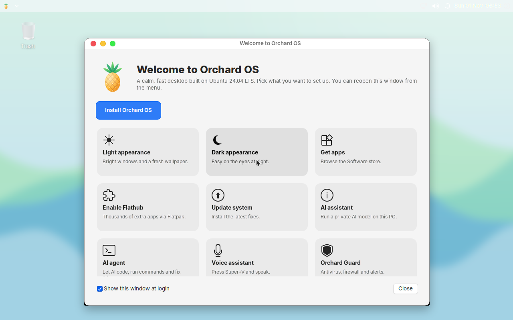

# Orchard OS

A macOS-styled, AI-ready Linux desktop you can install on any PC. Built on Ubuntu 24.04 LTS.



## What you get

**Look and feel (follows Apple's Human Interface Guidelines on materials)**
- Translucent menu bar, Dock, Spotlight and menus with real background blur (picom, dual-kawase)
- Rounded window corners (12 px), soft macOS-style shadows, short fade animations
- Window buttons on the left (close, minimize, maximize), centered titles
- WhiteSur GTK, icon and cursor themes; Inter and JetBrains Mono fonts
- Light and Dark appearance, switched in one click
- "Reduce transparency" switch for solid surfaces (same idea as the macOS accessibility setting)
- Original artwork: logo, wallpapers, boot splash, boot menu theme, login screen, login chime

**Productivity**
- Plank Dock at the bottom, top menu bar with app menu, status icons and clock
- Spotlight search: `Super+Space`
- macOS-like shortcuts: `Ctrl+Shift+3/4` screenshots, `Super+E` files, `Super+T` terminal
- Welcome app on first login with the common setup tasks

**AI (local first, cloud optional)**
- **Orchard Agent** (`orchard-agent`, `Super+C`): an AI agent in the terminal, similar in spirit to Claude Code. It plans, runs commands, reads and edits files, writes and tests code, searches and reads the web, and reports system status (CPU, memory, disk, GPU, network, failed services, listening ports, security alerts)
- Approval modes: `ask` (default, every action needs your OK), `auto` (read-only commands run automatically), `yolo` (all automatic, except the always-ask list such as `rm -rf /`, `mkfs`, `dd` to disks, `curl | sh`). File edits keep a `.orchard-bak` backup. Every prompt, tool call and decision is logged to `~/.local/share/orchard/agent/agent.log`
- Providers: **Ollama** on your PC (default, private), **Hugging Face**, **Groq**, **OpenRouter** (free models), **Google Gemini**, **Mistral**, or any OpenAI-compatible server (LM Studio, vLLM, llama.cpp). `orchard-agent key groq` stores a key, `orchard-agent use groq` switches
- `orchard-ai`: installs Ollama with NVIDIA CUDA / AMD ROCm support, picks a model that fits your RAM and GPU (`orchard-ai recommend`), downloads current models (Qwen 3, Qwen 2.5 Coder, Llama 3.2, Phi-4 mini, Gemma 3, DeepSeek-R1) or any GGUF from Hugging Face (`orchard-ai pull hf.co/USER/REPO`), measures speed (`orchard-ai bench`)
- **Ask AI** from anywhere: `Super+A`
- **Voice assistant** (`Super+V` push-to-talk, or say "Jarvis"/"Orchard" in hands-free mode with `orchard-voice listen`): offline speech recognition (Vosk) and speech output (eSpeak NG). Opens apps and switches modes directly, and sends everything else to Orchard Agent. System changes still ask for approval in a dialog
- The `ai`, `ai-models` and `jarvis` commands from earlier releases still work

**Security and reliability**
- **Orchard Guard**: checks every 5 minutes for new listening ports, failed logins and sudo attempts, programs running from `/tmp` or `/dev/shm`, long CPU hogs (crypto miners), and changes to users, sudoers, SSH and services. Alerts show as desktop notifications and go to `/var/log/orchard/guard-alerts.log`
- ClamAV antivirus with daily scans of Downloads and temp folders (`orchard-guard scan` for on-demand scans, ClamTk for a GUI)
- Firewall (ufw) on by default: incoming blocked, outgoing allowed
- auditd records changes to accounts, sudo rules, SSH and services. The journal is kept on disk
- **Restore points**: Timeshift snapshots, made automatically before package changes (once a day at most) and on demand (`orchard-restore create`)
- Memory management: zram compressed swap, earlyoom (stops the biggest memory hog before the desktop freezes), tuned swappiness

**Hardware**
- Graphics: Intel, AMD and NVIDIA (Nouveau) out of the box with Mesa, VA-API video decoding and Vulkan. `orchard-drivers` installs the proprietary NVIDIA driver and optionally the CUDA toolkit; a notification tells you when an NVIDIA GPU needs it
- Virtual machines: VirtualBox guest additions, VMware tools, QEMU/KVM (virtio, SPICE agent), Hyper-V tools
- Network: Ethernet, Wi-Fi (linux-firmware, NetworkManager), Bluetooth, VPN (OpenVPN)

**Apps and system**
- Epiphany browser, Thunar, Mousepad, Rhythmbox, Celluloid, Evince, Calculator, GParted, Disks
- Software store (GNOME Software) with Flatpak support, no Snap
- `orchard-update` updates everything, `orchard-clean` frees disk space
- Graphical installer (Calamares) with erase disk, dual boot, manual partitioning and disk encryption
- Command-line installer `orchard-install` for servers, VMs and automation
- Boots on BIOS and UEFI, from DVD or USB

## Install

1. Download `orchard-os-1.0-amd64.iso` from [Releases](https://github.com/mithun789/custom-linux-os-build/releases), or build it (below).
2. Write it to a USB stick (4 GB or larger) with balenaEtcher, Rufus (DD mode), or:
   ```bash
   sudo dd if=orchard-os-1.0-amd64.iso of=/dev/sdX bs=4M status=progress conv=fsync
   ```
3. Boot from the USB stick. Pick **Try or Install Orchard OS**.
4. Click **Install Orchard OS** in the Dock or the Welcome window and follow the steps.

| | Minimum | Recommended |
|---|---|---|
| CPU | 64-bit x86, 2 cores | 4+ cores with AVX2 |
| RAM | 4 GB (desktop only) | 8 GB for local AI (6 GB runs 1-3B models) |
| Disk | 20 GB | 50 GB+ (models are 1-5 GB each) |
| GPU | any (Intel, AMD, NVIDIA, VM) | NVIDIA with 6 GB+ VRAM for fast local AI |

Turn off Secure Boot in the firmware settings; the ISO is not signed.

Scripted install (erases the whole disk):

```bash
sudo orchard-install --disk /dev/sda --user alice --password 'secret' --hostname my-pc --timezone Europe/Berlin --yes
```

## Build the ISO

```bash
cd orchard-os
sudo ./build-iso.sh
```

Full instructions, the layout of the build system and how to change things: [orchard-os/README.md](orchard-os/README.md).

## Tests

`orchard-os/test/qemu-test.py` boots the ISO in QEMU on BIOS and UEFI, checks the live desktop and installer, installs to a virtual disk and boots the installed system. The GitHub Actions workflow `.github/workflows/orchard-iso.yml` runs the build and these tests and publishes the ISO when you push a `v*` tag.

## Earlier versions

The first Buildroot-based prototype (scripts and docs) lives in [legacy/](legacy/).

## Credits

- Ubuntu 24.04 LTS base, XFCE desktop, Plank, picom, Calamares
- WhiteSur GTK theme (MIT), WhiteSur icon and cursor themes (GPL-3.0) by vinceliuice
- Ollama for local AI models
